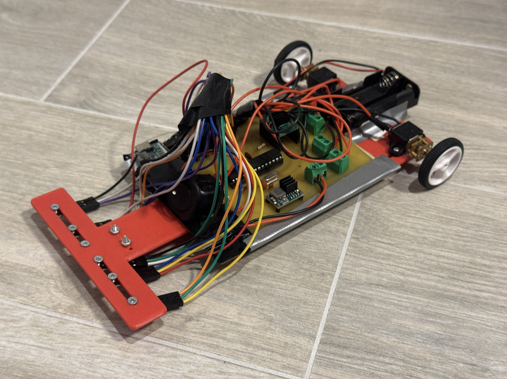
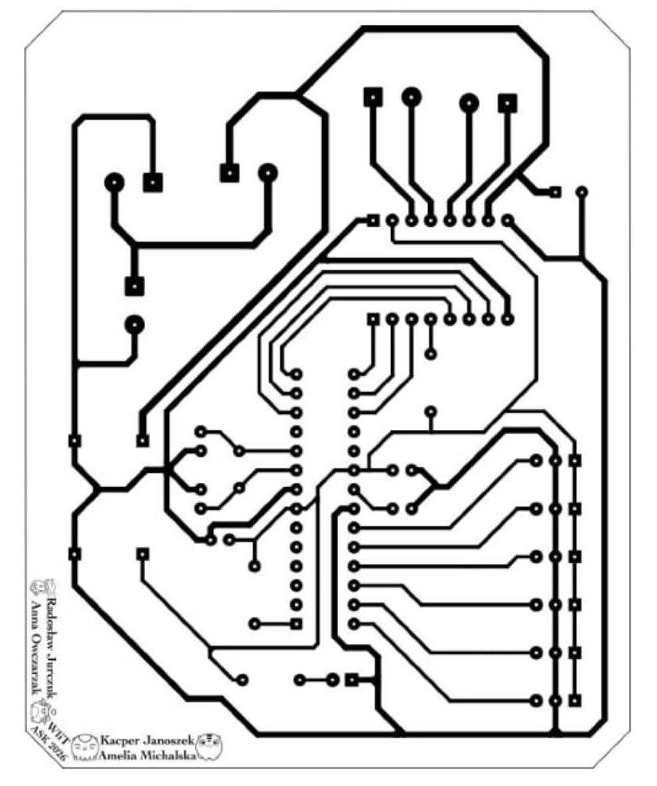

# Line Follower

A fast line-following robot built from scratch around the ATmega328P, featuring a hand-etched PCB.

**🥇 Winner of the "Fastest Line Follower" category at Roboday 2026 (May 15, 2026)**

## About

The robot was designed and built entirely in-house: from the schematic and PCB layout in KiCad, through hand-etching the board, to the firmware. The project focuses on simplicity, low cost and speed. All electronic components are through-hole (THT), and the whole robot cost less than 300 PLN.

The project was developed as part of the **Computer Systems Architecture** course at **Poznan University of Technology**.

## Features

- **ATmega328P @ 16 MHz** – standalone microcontroller, no development board.
- **6 KTIR0711S reflective sensors** – sensor array mounted on an extended front arm.
- **TB6612FNG motor driver** – differential drive with two Pololu micro motors.
- **2× Li-Ion 18650 power supply** – logic powered through a step-down converter.
- **Hand-etched PCB** designed in KiCad.
- **3D-printed chassis**.

## How It Works

1. **Detection** – the sensors measure light reflected from the surface and determine the line position relative to the robot's axis.
2. **Control** – the microcontroller calculates the position error and computes a speed correction for each wheel.
3. **Drive** – PWM signals are sent to the TB6612FNG driver, which controls the motors.

## PCB

## Firmware

The microcontroller firmware was written in the Arduino IDE and is located in the [`firmware/`](firmware/) folder.

## Hardware

| Component | Qty |
| --- | :---: |
| ATmega328P + 16 MHz crystal | 1 |
| TB6612FNG motor driver (Pololu 713) | 1 |
| KTIR0711S reflective sensor | 6 |
| Pololu micro motor + bracket (Pololu 989) | 2 |
| 32×7 mm wheel (Pololu 1088) | 2 |
| 3/8" Ball Caster (Pololu 951) | 1 |
| D-SUN step-down converter | 1 |
| Li-Ion 18650 cell, 2200 mAh | 2 |
| Custom PCB (hand-etched) | 1 |

## Authors

- **Name Surname** – [@login](https://github.com/)
- **Name Surname** – [@login](https://github.com/)
